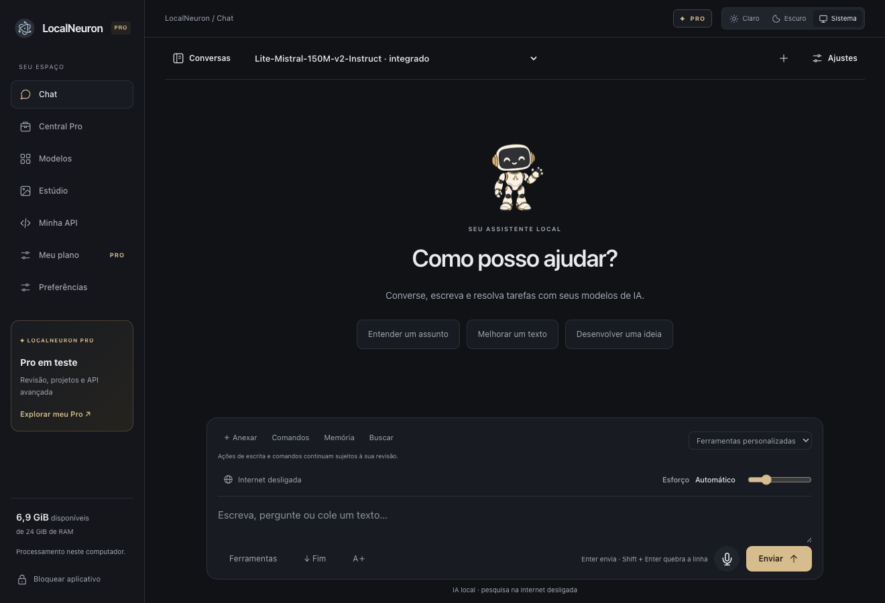

[](https://github.com/Arthur06311/localneuron/actions/workflows/ci.yml)

<p align="center"></p>
<h1 align="center">LocalNeuron</h1>
<p align="center"><strong>Sua IA. Seu computador.</strong><br>Converse, crie imagens, vídeos e músicas e conecte ferramentas com modelos de IA que rodam no seu próprio computador, sem conta e, depois de instalados, sem internet.</p>
<p align="center"><a href="https://github.com/Arthur06311/localneuron/releases"><strong>Baixar</strong></a> · <a href="https://localneuron.ai/">Site</a> · <a href="https://localneuron.ai/guide.html">Guia de configuração</a> · <a href="docs/comparacao-lm-studio.md">LocalNeuron e LM Studio</a> · <a href="https://github.com/Arthur06311/localneuron/issues">Reportar problema</a></p>

<!-- Substituir pela demo gravada (ver roteiro):  -->


*Interface 0.26 em espaço de demonstração. A ativação Pro de teste mostrada não acompanha os pacotes públicos.*

> **Alfa 0.27.0.** Funciona hoje para uso pessoal e testes. Ainda há validações pendentes (veja [Status](#status-da-alfa)).

## Por que LocalNeuron

- **Privado por padrão.** Conversas e arquivos ficam no seu computador. Depois que o modelo e o motor estão instalados, a inferência roda offline. Internet, MCP e APIs externas só entram quando você liga.
- **Tudo em um só lugar.** Chat, Imagem, Vídeo, Música e Editor no mesmo app, cada um com um motor local próprio.
- **Motores próprios, sem depender de outro app.** llama.cpp e MLX para texto, whisper.cpp para voz, stable-diffusion.cpp para imagem e vídeo, ACE-Step para música e EXO para dividir um modelo entre computadores. Não é preciso ter o LM Studio aberto.
- **Sua IA para outros apps.** A **Minha API** serve o modelo local em um endpoint compatível com OpenAI Chat Completions, com uma chave por cliente, cotas e revogação.
- **Escolhas informadas.** A biblioteca mostra RAM estimada, tamanho, licença e motor de cada modelo antes do download.

## Começar em 3 passos

1. **Baixe o instalador** na página de [versões](https://github.com/Arthur06311/localneuron/releases) (em *Assets*; “Source code” é só o código-fonte).

   | Sistema | Arquivo | Como instalar |
   |---|---|---|
   | macOS Apple Silicon | `LocalNeuron-macOS-arm64.dmg` (0.26) | Abra o DMG e arraste para Aplicativos |
   | Windows x64 | `LocalNeuron-Windows-x64.zip` (0.26) | Use “Extrair tudo” e abra `LocalNeuron.exe` na pasta extraída |
   | Linux x64 | [DEB ou PKG.TAR.GZ (0.27)](https://github.com/Arthur06311/localneuron/releases/tag/v0.27.0-linux.3) | Ubuntu/Debian: abra o DEB. Arch/Omarchy: `sudo pacman -U ./LocalNeuron-Linux-x64.pkg.tar.gz` |

2. **Abra e siga a configuração guiada.** O aplicativo entra direto, sem pedir senha. Informe seu perfil e confira a RAM e o disco do computador.
3. **Baixe um modelo pequeno e converse.** Em **Modelos**, escolha um modelo de texto Q4 marcado como compatível com o motor integrado. Depois abra o **Chat**. Em **Ferramentas → Usar offline**, a internet e o terminal ficam desligados.

Os modelos são baixados dentro do app, separadamente. O Mac ARM64 não roda em Mac Intel. Alguns motores têm requisitos próprios (por exemplo, imagem no Mac exige macOS 26+ e o EXO gerenciado exige macOS 26.2+). Veja os [requisitos por motor](docs/configuracao.md#requisitos) e o [guia Linux](docs/linux-installer.md).

## O que você pode fazer

| Área | O que faz | Bom saber |
|---|---|---|
| Chat | Streaming, Markdown, anexos, histórico, ramificações, memória revisável, internet opcional e esforço de raciocínio | Qualidade e contexto dependem do modelo e do hardware |
| Modelos | Catálogo com mais de mil entradas (inclui variantes), pesquisa no Hugging Face, RAM estimada, hashes e downloads retomáveis | Nem todo modelo catalogado tem execução integrada; confira o motor na ficha |
| Minha equipe | Bots pessoais e profissionais com instruções e permissões, equipe ativada em um clique e sala de colaboração | Os bots só trabalham quando você dá uma tarefa; não substituem serviços profissionais |
| Imagem / Vídeo | Perfis locais, recomendações, projetos, cenas, cortes, áudio e exportação | Hardware e codecs limitam a execução; muitos modelos visuais do catálogo são só referência |
| Música | ACE-Step 1.5 opcional: prompt ou letra, instrumental, BPM, biblioteca WAV, recorte e fades | Instalação separada (25 GiB livres); geração real verificada no Mac Apple Silicon |
| Voz | Transcrição local com Whisper; narração (Pro) com a voz do sistema em português brasileiro | Transcrição precisa de modelo e permissão do microfone. Narração precisa de uma voz pt-BR instalada no sistema |
| Editor | A IA propõe cortes por metadados e cria uma nova timeline no DaVinci Resolve Studio depois da sua revisão | Requer Resolve Studio; não analisa o conteúdo dos vídeos; testado com SDK simulado |
| Minha API | Chaves, cotas e endpoint compatível com Chat Completions para texto | Máquina anfitriã ligada; rede privada/VPN; não implementa toda a API OpenAI |
| Rede EXO | Nó local no Mac, descoberta, escolha de máquinas e preparação distribuída | Só modelos suportados pelo EXO; teste com duas máquinas físicas pendente |
| Conexões MCP | Servidores HTTP/stdio, OAuth quando suportado, permissões por bot e revisão | Cada serviço precisa da sua autorização; nada conecta sozinho ao Gmail ou Drive |
| Pro | Projetos, entregas, fila, revisão e recursos avançados com licença assinada | Cobrança pública ainda não ativada; não é preciso Pro para rodar modelos locais |

**Personalidade opcional:** em Preferências, a opção “Usar a personalidade LocalNeuron” começa desligada. As instruções dos seus bots são preservadas.

## Motores locais

| Motor | Para quê | Plataformas |
|---|---|---|
| llama.cpp (b10809) | Texto GGUF | Mac (Metal), Windows e Linux (CPU nos pacotes incluídos) |
| MLX + MLX LM | Texto em Apple Silicon, processo sem acesso à rede | Mac Apple Silicon, macOS 14+ |
| whisper.cpp | Transcrição de voz | Mac, Windows, Linux |
| Voz do sistema | Narração em português brasileiro (`say` no Mac, SAPI no Windows, `spd-say` no Linux) | Mac, Windows e Linux com speech-dispatcher. Sem voz pt-BR, a narração fica desativada |
| stable-diffusion.cpp | Imagem (SD 1.5) e vídeo (Wan 2.1) em perfis integrados | macOS 26+, Windows x64, Linux compatível |
| ACE-Step 1.5 | Música, instalado à parte | Validado no Mac Apple Silicon |
| EXO 1.0.71 | Dividir um modelo de texto entre computadores | Nó gerenciado em Mac com macOS 26.2+; outros sistemas controlam um EXO existente |
| DaVinci Resolve SDK | Ponte local com o Editor | Requer Resolve Studio instalado (não incluído) |

Versões, origens e hashes estão em `runtime/*manifest.json`. Veja também os [componentes e licenças de terceiros](THIRD_PARTY.md). Cada modelo tem sua própria licença. ChatGPT não é um modelo para baixar; gpt-oss é uma família de pesos abertos diferente.

A narração usa a voz do sistema e não baixa a voz Faber. Quando o sherpa-onnx 2.0.0 publicar um build sem eSpeak NG, a voz neural pode voltar; o acompanhamento está em [k2-fsa/sherpa-onnx#3731](https://github.com/k2-fsa/sherpa-onnx/issues/3731).

## Perguntas frequentes

**Preciso de internet?** Sim, para baixar o app, os modelos e os motores. Depois disso, os motores compatíveis rodam offline. Pesquisa web, MCP e APIs externas usam a rede quando você liga essas opções.

**É grátis?** Baixar e rodar modelos locais compatíveis não exige pagamento nem conta em provedor de IA. O plano Pro é opcional e a cobrança ainda não está ativada.

**Preciso do LM Studio?** Não. O LocalNeuron tem motores próprios. Se você já tem GGUFs na pasta do LM Studio, eles são encontrados e reutilizados sem copiar os pesos. Veja a [comparação](docs/comparacao-lm-studio.md).

**Qual modelo devo baixar primeiro?** Um modelo de texto pequeno em Q4 que caiba com folga na sua RAM. A ficha mostra a estimativa, mas ela não substitui um teste real.

**Meus dados ficam protegidos?** Conversas e arquivos ficam no seu computador. O cofre dos segredos é cifrado com uma chave aleatória guardada pelo sistema, **não todas as conversas**. Proteja também a sua conta do sistema e faça backup da pasta de dados com o app fechado.

**Funciona no Mac Intel?** Não. O pacote Mac é só para Apple Silicon.

**Por que o sistema mostra um aviso ao abrir?** Os pacotes da alfa ainda não têm assinatura de distribuição. O Mac tem assinatura ad hoc, sem notarização Apple. Confira a origem e o SHA-256 antes de abrir.

**Onde mudo modelos, API e conexões?** Dentro do aplicativo. O site público só explica as configurações e não recebe dados seus. Não há senha do aplicativo para alterar.

## Privacidade e segurança

Conversas e arquivos ficam no espaço local. Downloads, pesquisa web, MCP e APIs externas se comunicam apenas com os serviços que você escolher. O painel administrativo escuta em loopback e exige sessão. A Minha API é separada e fica desligada por padrão. O EXO usa a autenticação do projeto upstream: a identificação de rede não é senha. Use uma rede privada confiável ou VPN e não exponha essas portas diretamente à internet.

No site, a seleção automática de idioma consulta `country.is` pelo navegador, o que envia seu IP a esse serviço para estimar o país. Se a consulta falhar, o site usa o idioma do navegador. A escolha manual fica só no seu navegador. O GitHub pode manter registros técnicos da hospedagem.

## Status da alfa

Na versão 0.28, `npm test` reúne **253 testes automatizados: 202 da suíte TypeScript do aplicativo e 51 em JavaScript**. Oito deles cobrem a narração pela voz do sistema. O mock de acesso local no Linux foi corrigido no PR #6, e o workflow de CI roda `npm test`; veja o [estado de validação](docs/project-organization-and-migration.md#8-estado-de-validação-e-riscos). A interface foi conferida no Mac em tamanhos de desktop e compacto, incluindo uma tarefa real com modelo local. Os pacotes públicos não contêm conversas, chaves privadas nem a licença Pro de teste do proprietário.

Ainda pendentes: notarização Apple, execução nativa de motores/GPU no Windows e no Linux, EXO com duas máquinas físicas e integração com uma instalação real do Resolve Studio. O aplicativo continua **alfa**, sem promessa de suporte universal a modelos ou hardware. Veja as [novidades da 0.27](docs/localneuron-0.27.md). Os guias antigos em `docs/localneuron-*` registram o estado de cada versão.

## Documentação

- [Guia completo: instalação, motores, bots, API, EXO, backup e solução de problemas](docs/configuracao.md)
- [Música, Editor e personalidade](docs/creative-studio.md) · [Rede EXO](docs/exo.md) · [Minha API](docs/minha-api.md) · [MLX e offline](docs/mlx-independente.md)
- [Ferramentas do assistente](docs/motor-e-assistente.md) · [Plataformas](docs/plataformas.md) · [LocalNeuron e LM Studio](docs/comparacao-lm-studio.md)
- [Arquitetura](docs/architecture.md) · [API administrativa local](docs/api.md) · [Índice da documentação](docs/README.md)
- [Operação da assinatura](docs/subscription-operations.md) · [Publicar o site e versões](docs/github-publicacao.md) · [Mapa do projeto e migração](docs/project-organization-and-migration.md)

## Desenvolvimento

Requer **Node.js 24+**, npm e Python 3 para preparar os runtimes. Os testes de contrato não precisam baixar modelos grandes.

```sh
git clone https://github.com/Arthur06311/localneuron.git
cd localneuron
npm ci
npm test
python3 tests/resolve_bridge_test.py
```

Interface em desenvolvimento:

```sh
npm start
# Em outro terminal: abre a sessão local autenticada
node scripts/open.mjs
```

Prepare os motores antes da primeira inferência. Exemplo no Mac Apple Silicon:

```sh
python3 scripts/fetch-runtime.py darwin-arm64
python3 scripts/fetch-mlx.py
python3 scripts/fetch-tools.py darwin-arm64
npm run desktop
```

Use os alvos dos manifests nas outras plataformas ([distribuição](docs/plataformas.md)). O painel prefere a porta 4317 em desenvolvimento e 4318 no desktop. Se a porta estiver ocupada, a próxima livre é usada e a sessão local recebe a porta real. Os nomes preferidos são `LOCALNEURON_DATA_DIR`, `LOCALNEURON_DESKTOP_DATA_DIR` e `LOCALNEURON_PORT`. Os nomes legados `COLMEIA_DATA_DIR`, `COLMEIA_DESKTOP_DATA_DIR`, `COLMEIA_PORT` e as pastas `Colmeia` continuam aceitos.

```text
src/          Serviço local, motores, API e persistência
desktop/      Electron, permissões e pontes Python
public/       Interface do aplicativo
runtime/      Manifests e protocolos; pesos ficam fora do Git
website/      Site estático publicado pelo GitHub Pages
docs/         Guias de uso e operação
scripts/      Preparação, verificação e empacotamento
tests/        Testes automatizados e fixtures sintéticas
```

## Contribuição e licença

Para reportar um problema, informe versão, sistema, modelo/motor, passos e mensagem de erro. Remova tokens, prompts privados e caminhos pessoais. Consulte [CONTRIBUTING.md](CONTRIBUTING.md) e [SECURITY.md](SECURITY.md).

O LocalNeuron é software proprietário, de código fechado, com todos os direitos reservados. Copyright (c) 2026 Arthur Pinheiro Kriger. All rights reserved. Não há permissão de cópia, modificação nem redistribuição do código próprio sem autorização escrita do titular. Os termos estão em [LICENSE](LICENSE). Os componentes de terceiros e os modelos mantêm suas próprias licenças.
